<div align="center">

```
  _      _   ___ ___ _______   ___
 /_\    /_\ |   \_ _|_   _\ \ / /_\
/ _ \  / _ \| |) | |  | |  \ V / _ \
/_/ \_\/_/ \_\___/___| |_|   |_/_/ \_\
```

# Aaditya Khurana

**CSE Diploma @ Thapar Polytechnic College · App & Web Developer · Patiala, India**

[](https://www.linkedin.com/in/aaditya-khurana-6217a5410)
[](mailto:aadityakhurana55555@gmail.com)

</div>

---

### about

```txt
first-year CSE diploma student at Thapar Polytechnic College (2026-2029), based in Patiala.
i build app and web prototypes that solve small, real problems - and ship them live.

winner, Zinnovatio 4.0 @ Chandigarh University (team Grexars, NagarTrace)
1st, Hackathon 2026 (SIH internal round), Thapar Polytechnic College
```

<div align="center">



</div>

### project technologies

<div align="center">


</div>

### projects

| project | tech | what it is |
| --- | --- | --- |
| [NagarTrace](https://github.com/KhuranaCode/NagarTrace) · [live](https://khuranacode.github.io/NagarTrace/) | typescript, react, fastify, postgres | pothole report-to-repair app prototype. Zinnovatio 4.0 winner (team Grexars). |
| [StudyPilot](https://github.com/KhuranaCode/Studypilot) · [live](https://khuranacode.github.io/Studypilot/) | typescript, react, firebase | study-planning prototype with scheduling, focus and deadline tools. |
| [PROVIQRA](https://github.com/KhuranaCode/PROVIQRA) · [live](https://khuranacode.github.io/PROVIQRA/) | javascript, react, three.js | front-end prototype for an opportunity network matching on skills, proof-of-work and intent. demo data. |
| [CarCohort](https://github.com/KhuranaCode/carcohort) · [live](https://khuranacode.github.io/carcohort/) | javascript, react | group car-buying prototype: buyers team up, dealers compete on on-road price. concept build, sample data. |
| [CamRush](https://github.com/KhuranaCode/CamRush) · [live](https://khuranacode.github.io/CamRush/) · team project | javascript, mediapipe | camera-gesture arcade with hand/face tracking, shown at the college fest. |
| [Zep Pay](https://github.com/KhuranaCode/zeppay) · team project | flutter, dart | offline UPI payments prototype. |

### stats

<div align="center">


<!-- contribution snake: appears after the GitHub Action in .github/workflows/snake.yml has run once -->
<picture>
  <source media="(prefers-color-scheme: dark)" srcset="https://raw.githubusercontent.com/KhuranaCode/KhuranaCode/output/github-contribution-grid-snake-dark.svg">
  <source media="(prefers-color-scheme: light)" srcset="https://raw.githubusercontent.com/KhuranaCode/KhuranaCode/output/github-contribution-grid-snake.svg">
  
</picture>

</div>
